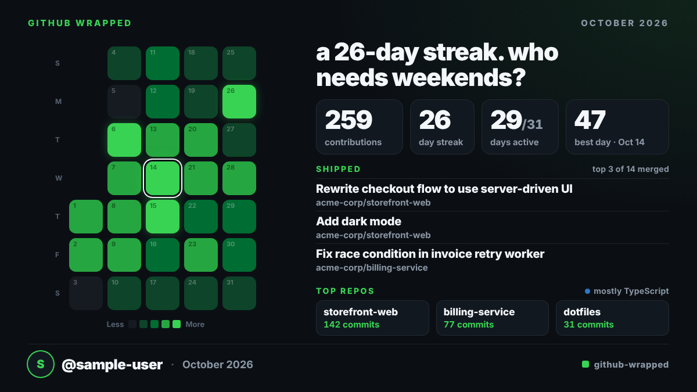

# GitHub Wrapped

Turn one month of anyone's GitHub activity into a shareable, Twitter/X-sized PNG card (1200×675): the month's contribution grid, a few big stats, what got merged, and a one-line tagline.



<sub>The example above is generated from synthetic sample data (`npm run sample`), not a real account.</sub>

## What's on the card

- **The grid**: the month as GitHub-style green squares (weeks as columns, Sunday-first). Colour levels are relative to the month itself; the best day gets a ring. Days that haven't happened yet are dashed.
- **Four stats**: total contributions, longest streak, active days (out of the month's days), best day.
- **Shipped**: the top 3 merged PRs of the month, ranked by size (additions + deletions, then comments), with their repos. With no merged PRs it becomes a per-category breakdown, or disappears if there's nothing to show.
- **Top repos**: top 3 by commit count, plus the top repo's main language.
- **A tagline** picked by simple rules from the stats ("31/31 days. no days off.", "weekends are for shipping."). No AI, no network. See [`src/tagline.mjs`](src/tagline.mjs).
- **Footer**: avatar, `@username`, month, and a watermark you can change.

## Quick start

You need three free tools first. Install each one, then **close and reopen your terminal** (on Windows: Command Prompt or PowerShell).

1. **Node.js 20 or newer**: [nodejs.org](https://nodejs.org/) (download the LTS version). Check with `node -v`.
2. **Git**: [git-scm.com](https://git-scm.com/downloads). Or skip it and use **Code → Download ZIP** on the GitHub page, then unzip.
3. **GitHub CLI**: [cli.github.com](https://cli.github.com/). This is how the tool is allowed to read GitHub data.

Then run these one at a time. Type or paste **only the command itself**, nothing after it.

Download the project and go into its folder:

```
git clone https://github.com/saymirr/GITHUB-WRAPPED
```

```
cd GITHUB-WRAPPED
```

Install it (this also takes a minute):

```
npm install
```

Download the browser it uses to draw the card (one time, about 150 MB):

```
npx playwright install chromium
```

Log in to GitHub (follow the prompts; pick "GitHub.com" and "Login with a web browser"):

```
gh auth login
```

Make your first card:

```
node wrapped.mjs
```

It asks two questions. Press **Enter** at the first to use your own account, and type `last` at the second for last month (or press Enter for this month, or type a month like `2026-09`). It then saves a picture in the same folder as `wrapped-<username>-<YYYY-MM>.png` and opens it.

Every command must be run **inside the `GITHUB-WRAPPED` folder** (after the `cd` step). If you open a new terminal later, `cd` back into it first.

## Usage

Replace the parts in `<angle brackets>` with your own values (without the brackets).

| I want... | Command |
|---|---|
| to be asked what to do | `node wrapped.mjs` |
| someone's card for this month | `node wrapped.mjs <username>` |
| last month | `node wrapped.mjs <username> --last` |
| a specific month | `node wrapped.mjs <username> <YYYY-MM>` |

Leave the username out to use your own account, for example `node wrapped.mjs --last`.

For example, `node wrapped.mjs octocat 2026-09` makes September 2026 for the user `octocat`. The username always comes first, then the month.

Optional extras go at the end:

| Option | What it does |
|---|---|
| `--last` | Use last month instead of typing a `YYYY-MM` |
| `-o, --out <file>` | Choose the output file name |
| `--public-only` | Hide private repos, even on your own card (use this before posting it) |
| `--scale <1-4>` | Sharper image; `2` gives 2400×1350 (default `1`) |
| `-h, --help` | Show the built-in help |

The current month is labelled "so far" until it ends.

> **No `gh`?** Instead of `gh auth login` you can set a `GITHUB_TOKEN` environment variable with a GitHub personal access token. The tool uses it only when `gh` isn't installed.

## Privacy and tokens

- **Your token is never logged, printed, or written to disk.** With `gh`, the token is handled entirely by the GitHub CLI. In the `GITHUB_TOKEN` fallback it is sent only as an `Authorization` header to `api.github.com`, and error messages never include it.
- The tool talks only to `api.github.com` (GraphQL) and GitHub's avatar CDN. No telemetry, no other services.
- **Other people's cards are public-data-only.** Private (and internal) repositories, and the PRs inside them, are filtered out in the data layer ([`src/github.mjs`](src/github.mjs)), before stats or rendering ever see them, so their names and titles can't end up on the image, even if your token can read those repos. The search also adds `is:public`.
- **Your own card includes your private repo and PR names**, because it's your data. Before posting it publicly, either check what's on it or generate it with `--public-only`.
- Daily counts and totals include private activity only if the account has "Include private contributions on my profile" enabled. Those are numbers only, never names.
- `gh auth login`'s default scopes are enough. A fine-grained token with read-only public access works for public data (your own private repos need `repo` read access).

## Customize

Everything visual lives in [`src/config.mjs`](src/config.mjs): theme colors, font family and files, grid sizing, card size, and the **footer watermark** (`watermark`, currently a placeholder). Tagline rules are a plain priority-ordered list in [`src/tagline.mjs`](src/tagline.mjs).

## How it's organized

Fetching, stats and rendering are separate, I/O-free-where-possible modules, so a web version can reuse them:

| Module | Job | I/O |
|---|---|---|
| `src/github.mjs` | GraphQL queries, privacy filtering, normalizing | network (`gh` / `fetch`) |
| `src/stats.mjs`, `src/tagline.mjs` | totals, streaks, levels, ranking, tagline | none |
| `src/html.mjs` | stats → self-contained HTML string | none |
| `src/png.mjs` | HTML → PNG via Playwright | browser |
| `src/config.mjs`, `src/fonts.mjs` | theme/fonts/watermark; font embedding | file read |
| `wrapped.mjs` | CLI wiring | |

A web version would call `fetchMonthData()` with its own `run(query, variables)` function, then `computeStats()` and `renderCardHtml()`, and serve the HTML (or screenshot it server-side).

## Development

- `npm test` runs the unit tests (no network or token needed).
- `npm run sample` regenerates `docs/example.png` from synthetic data.
- `node scripts/render-sample.mjs --all out/` renders every edge-case layout so you can eyeball them.

The tests cover stats, tagline rules, HTML escaping, the privacy filter, and the `gh`/`fetch` transport (against a fake `gh`).

## Notes and limits

- Dates are handled in UTC, like GitHub's contribution calendar.
- Merged PRs are ranked from up to 500 PRs per month.
- Fonts: [Inter](https://github.com/rsms/inter) (SIL OFL 1.1) is bundled in `assets/fonts` and embedded in the HTML, so cards look the same everywhere.

## Troubleshooting

| Message | Fix |
|---|---|
| `'node' is not recognized` / `command not found: node` | Install Node.js, then close and reopen the terminal |
| `'gh' is not recognized` / `command not found: gh` | Install the GitHub CLI, then close and reopen the terminal |
| `Invalid installation targets: '#', ...` | You pasted a comment after the command. Run just `npx playwright install chromium` |
| `Could not read package.json` / Playwright says "without first installing your project's dependencies" | You're not in the project folder. Run `cd GITHUB-WRAPPED`, then `npm install` |
| `Chromium is not installed for Playwright` | `npx playwright install chromium` |
| `GitHub rejected the credentials` / `No GitHub credentials found` | `gh auth login`, or set `GITHUB_TOKEN` |
| `GitHub API rate limit reached` | Wait and retry; limits reset hourly |
| `GitHub user "x" not found` | Check the spelling; the username comes before the month |

## License

[MIT](LICENSE). The bundled Inter font is under the [SIL Open Font License](assets/fonts/LICENSE-Inter.txt).
